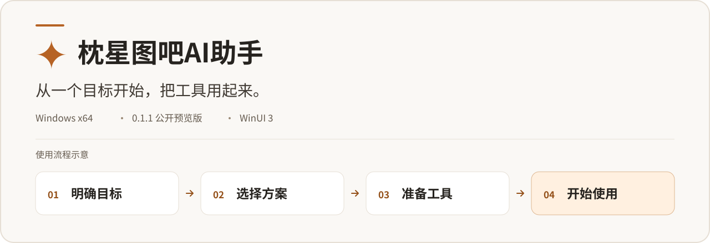
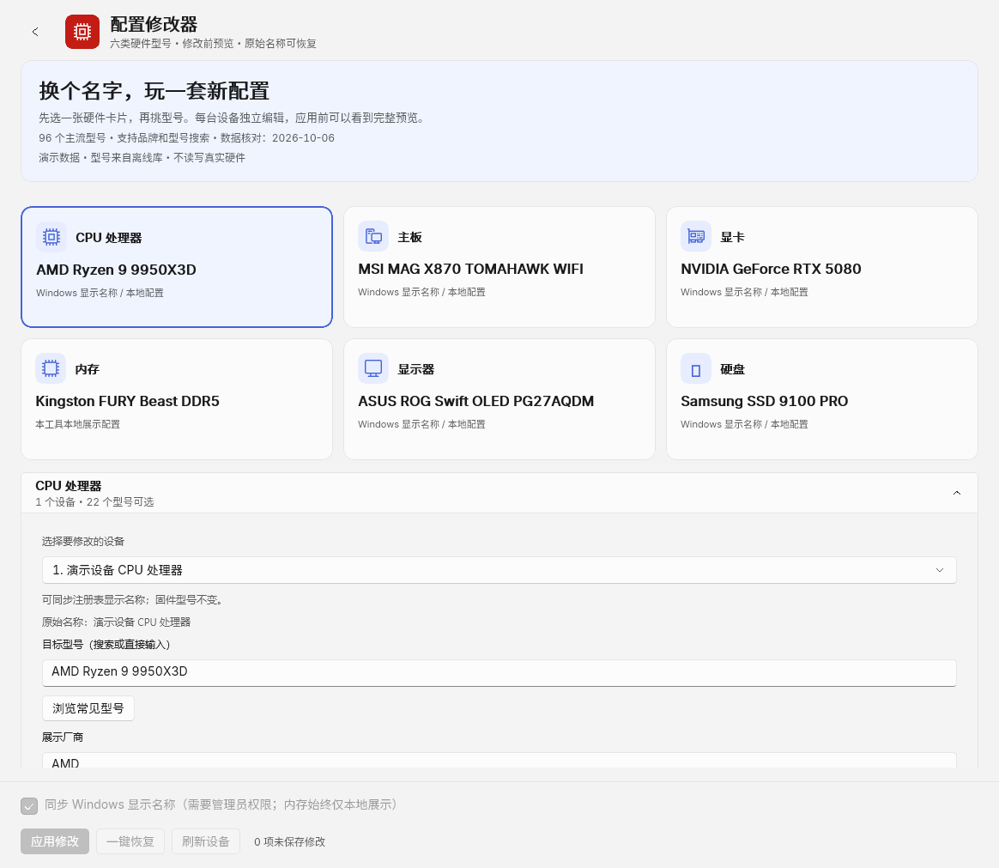

<picture>
  <source media="(prefers-color-scheme: dark)" srcset="docs/assets/readme/brand-dark.svg">
  
</picture>

**面向 Windows 的 AI 任务工作台与电脑工具中心**

[**官网下载**](https://zhenxingai.com/download) · [**GitHub 下载**](https://github.com/yujinchuan2021-max/zhenxing-ai-assistant/releases/tag/v0.1.1-preview) · [**快速开始**](docs/getting-started.md) · [**功能总览**](docs/features.md)

[官网](https://zhenxingai.com/) · [使用文档](https://zhenxingai.com/docs) · [AI 资讯](https://zhenxingai.com/ai-news/) · [枕星AI社区](https://community.zhenxingai.com/) · [问题反馈](https://github.com/yujinchuan2021-max/zhenxing-ai-assistant/issues)

---

**枕星图吧AI助手**把目标规划、软件准备和电脑日常工具放在同一个工作台。你可以先说出想完成的事，也可以直接找工具：查看硬件、管理软件、使用技能、运行测试、整理文件或排查网络。

当前公开版为 **0.1.1 预览版 · Windows x64**。客户端采用 WinUI 3 / .NET 10，本项目基于 [图吧工具箱 CE / TubaWinUi3](https://github.com/luolangaga/tubatools) 继续开发。

## 从一个目标开始

| 你想做什么 | 枕星帮你准备什么 |
| --- | --- |
| **“我想做一款 Windows 2D 游戏”** | 确认平台、预算和账号条件，比较 Agent 与引擎方案，复用已安装软件，准备工具并给出打开入口。 |
| **“我想用 AI 做音乐或图片”** | 根据所需结果选择服务，说明账号与使用条件，提供开始创作的入口。 |
| **“新电脑怎么验机？”** | 汇总硬件配置，选择检查与测试工具，准备需要的软件并说明如何使用。 |
| **“电脑卡顿，帮我排查”** | 结合实际现象查看硬件、磁盘和系统状态，逐步选择诊断工具。 |

工作台按 **明确目标 → 选择方案 → 准备工具 → 开始使用** 推进。已确认的信息继续沿用，符合条件的已安装软件优先复用。工具准备完成后，开发、创作或测试在选定软件中继续。

## 功能一览

<table>
  <tr>
    <td width="50%" valign="top">
      <h3>AI 任务工作台</h3>
      
描述需求、回答关键选项、比较方案、确认准备清单，随时查看当前步骤与下一步。

      
统一配置模型服务；选型时考虑预算、账号、网络、平台和硬件条件。

    </td>
    <td width="50%" valign="top">
      <h3>应用与工具中心</h3>
      
查看本机软件和下载任务，打开工具、定位文件、创建支持的桌面快捷方式。

      
内置系统功能直接使用；第三方工具按需获取，已安装的受管便携工具支持批量更新。

    </td>
  </tr>
  <tr>
    <td valign="top">
      <h3>硬件、测试与维护</h3>
      
汇总 CPU、主板、显卡、内存、显示器和硬盘信息，选择诊断、性能测试与维护工具。

      
提供系统管理、文件与磁盘、网络诊断、游戏辅助及格式转换等分类入口。

    </td>
    <td valign="top">
      <h3>技能查找与制作</h3>
      
分类浏览、全库搜索、查看说明和来源；瀑布流先加载两页，滚动继续加载。

      
在本机编辑、制作和试用技能，按需导入，再主动投稿至审核流程。

    </td>
  </tr>
  <tr>
    <td valign="top">
      <h3>配置展示与性能记录</h3>
      
配置修改器编辑六类硬件的展示名称，支持型号搜索、逐设备选择和自定义输入。

      
性能测试可查看或导出报告，用户主动提交成绩后进入公开排行榜审核流程。

    </td>
    <td valign="top">
      <h3>资讯、社区与经验</h3>
      
阅读带来源的 AI 资讯与原文，交流目标方案、工具使用、教程和问题反馈。

      
公开资讯可直接阅读；个人 AI 摘要按需使用自己的模型配置，社区使用独立账号。

    </td>
  </tr>
</table>

查看[逐项功能与使用条件](docs/features.md) · [官网功能总览](https://zhenxingai.com/features) · [工具获取方式](https://zhenxingai.com/tools/acquire)

<strong>配置修改器界面预览</strong>

<picture>
  <source media="(prefers-color-scheme: dark)" srcset="docs/assets/hardware-editor/overview-dark.png">
  
</picture>

该预览使用演示设备，不读写真实硬件。它编辑展示名称，第三方软件仍可能读取真实设备信息；内存名称仅保存在本地展示配置。支持范围见[功能说明](docs/features.md#配置修改器)。

[独立工具源码](https://github.com/yujinchuan2021-max/zhenxing-hardware-editor) · [独立版 0.1.0 发行页](https://github.com/yujinchuan2021-max/zhenxing-hardware-editor/releases/tag/v0.1.0)

## 快速开始

1. **下载并完整解压。** 从[官网](https://zhenxingai.com/download)或 [GitHub 发行页](https://github.com/yujinchuan2021-max/zhenxing-ai-assistant/releases/tag/v0.1.1-preview)取得 Windows x64 完整 ZIP，解压到一个新文件夹，运行根目录的 **`枕星图吧AI助手.exe`**。
2. **按需要配置 AI。** 在“设置 → AI 与 Agent”填写服务地址、模型和凭据并测试连接。不使用 AI 时，仍可使用本机工具、应用中心、公开技能目录及公开资讯。
3. **开始第一个任务。** 在首页描述目标，比较方案并确认准备清单；或直接进入工具分类。准备完成后打开所选软件，CLI 按页面提供的终端说明使用。

详细步骤：[新手指南](docs/getting-started.md) · [常见问题](docs/faq.md)

## 下载与更新

| 内容 | 入口与方式 |
| --- | --- |
| **客户端完整包** | [官网国内下载](https://zhenxingai.com/download) / [GitHub 发行页](https://github.com/yujinchuan2021-max/zhenxing-ai-assistant/releases/tag/v0.1.1-preview)；当前维护包为 `20261007-fix3`。 |
| **更新客户端** | 客户端提供下载、校验和新版提示；关闭旧版后，完整解压到新文件夹并启动。保留原数据目录，参照[升级说明](docs/getting-started.md#升级与反馈)。 |
| **更新工具** | 应用中心“全部更新”用于已安装的受管便携工具。原厂安装器、商店和网页工具按各自流程处理。 |
| **取得第三方软件** | [官网工具下载页](https://zhenxingai.com/tools/download) / [获取与使用步骤](https://zhenxingai.com/tools/acquire)；查看来源、版本、架构和所需账号。 |
| **对应版本源码** | [0.1.1 修订源码](https://github.com/yujinchuan2021-max/zhenxing-ai-assistant/tree/v0.1.1-revision-20261007-batch-update)；开发与研究记录可与已发布包有所不同。 |

<strong>当前包信息、校验与发行记录</strong>

| 项目 | 当前公开包 |
| --- | --- |
| 公开版本 / 内部版本 | 0.1.1 公开预览版 / 0.1.1.2 |
| 文件名 | `ZhenxingAI-v0.1.1-preview-20261007-fix3.zip` |
| 大小 | 336,234,234 字节 |
| SHA-256 | `30f24bd47f6b67e3a09578e6a4383d2d08ccde367ca2c6dbbb48f1fc266b85fa` |

[批量更新修订说明](docs/releases/0.1.1-batch-update-20261007.md) · [发布验证记录](docs/releases/0.1.1-batch-update-20261007-publication-validation.json) · [首次发行说明](docs/releases/0.1.1-preview.md)

0.1.1 发布时有 74 个提供受管便携包的目录工具；安装器、网页、商店及其他获取流程另行说明，存在交集，不能将各目录数量简单相加。当前资源状态以[实际获取目录](https://zhenxingai.com/tools/acquire)为准，详细范围见[分发说明](docs/tool-distribution.md)。

## 使用条件

| 项目 | 说明 |
| --- | --- |
| **系统与架构** | 当前发布 Windows x64 便携包。工程最低目标为 Windows 10 2004（build 19041），主要验证环境为 Windows 11；未提供 x86 / ARM64 发行包。 |
| **运行环境** | 完整包携带 .NET 运行时；资讯、社区等内置网页需要可用的 WebView2 环境。请保留解压目录中的全部文件。 |
| **模型与费用** | AI 功能使用你配置的模型 API 或兼容本地服务。模型服务、外部 Agent 的账号、订阅与费用由相应服务提供方决定。 |
| **权限与网络** | 部分系统操作需要确认 Windows 授权。官网受管工具可从自有来源获取；其他来源、账号登录及厂商服务仍有各自的网络条件。 |

## 常见问题

<strong>没有模型 API，也能用吗？</strong>

可以使用不依赖模型的本机工具、应用中心、公开技能目录和公开资讯。对话、AI 技能制作与个人摘要需要可用的 AI 配置。兼容本地服务也需要先确认模型及硬件要求。

<strong>确认方案后，所有软件都会自动安装吗？</strong>

支持的准备流程会继续下载、校验和准备工具；安装器、账号登录、商店授权、重启或制作启动介质可能仍需用户操作。工作台按实际结果显示状态，选定工具中的开发、创作和测试继续由对应软件完成。

<strong>“移除记录”和“卸载”有什么区别？</strong>

移除记录只取消客户端的软件登记。卸载使用该软件支持的实际卸载流程；是否仍安装，以系统及软件的检测结果为准。

<strong>修改展示名称后，硬件真的变了吗？</strong>

配置修改器编辑本机展示配置及支持的系统显示字符串。真实设备、性能和第三方软件的底层检测不会因此改变；硬件检测与排行榜继续使用实际检测结果。

更多问题见[完整 FAQ](docs/faq.md)，反馈时请提供版本号、系统、复现步骤和脱敏截图。

## 数据与隐私

模型请求发送到你配置的服务，API Key 使用 Windows 当前用户的数据保护机制保存在本机。下载、资讯、社区、搜索与主动投稿等功能会联网。

**工具流分享默认开启，可在设置中关闭。** 分享可能包含目标、完整方案、该会话的完整可见对话及执行结果。关闭后停止新的分享上传，关闭期间的记录不会补传，已到达服务器的记录不会因关闭而删除。技能和跑分投稿需要另外主动提交。详见[隐私说明](PrivacyPolicy.txt)。

## 开源与参与

我们欢迎问题反馈、使用经验、技能与工具信息维护，也欢迎改进代码和文档。

[构建说明](docs/build.md) · [贡献指南](CONTRIBUTING.md) · [问题反馈](https://github.com/yujinchuan2021-max/zhenxing-ai-assistant/issues) · [安全反馈](SECURITY.md)

本项目是 [图吧工具箱 CE / TubaWinUi3](https://github.com/luolangaga/tubatools) 的独立衍生版本，保留上游来源与署名，依据 [GNU GPL v3.0](LICENSE) 发布。第三方字体、图标、运行时和工具保留各自许可，详见 [NOTICE](NOTICE) 与[随包许可说明](License.txt)。源码仓库不包含完整第三方工具集合、个人凭据或用户数据。

发布签名与认证以[本项目对应发行说明](docs/faq.md#当前版本有代码签名或第三方认证吗)为准。历史 Electron 版本和未发布研究记录保留于 Git 历史及文档，其能力与更新机制分别说明。
